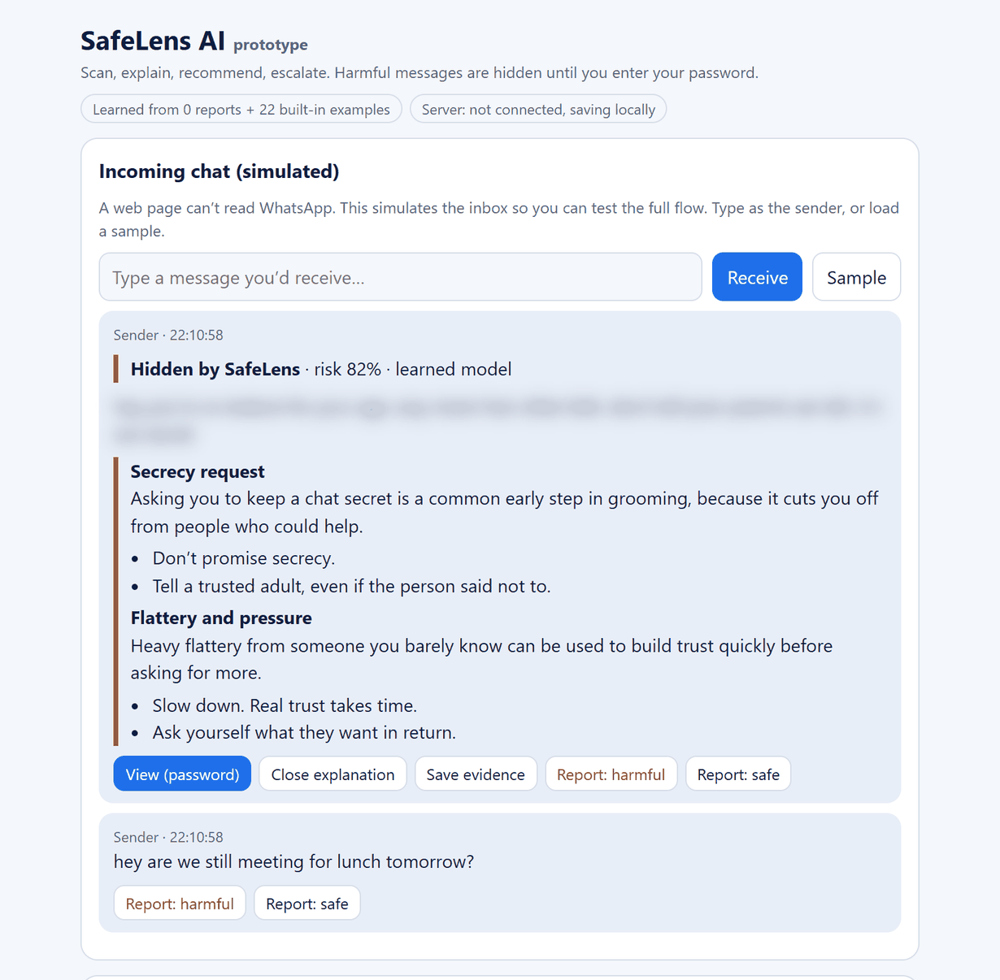

# SafeLens AI (prototype)

A browser prototype of an online safety companion for young people. It scans messages, hides harmful ones behind a password, explains why they are risky, suggests next steps, and helps build an evidence file for escalation.

**▶ Live demo: [jadenchua-dot.github.io/Safe-Lens-AI](https://jadenchua-dot.github.io/Safe-Lens-AI/)** (set any password, then press **Sample** to receive test messages)

Built in a team of three (Jaden Chua, Justin and Hong Sen) at GovTech's **Digital4Good hackathon** on 6 Nov 2026, for problem statement 3, "Report Inappropriate Content": how might we help youths recognise online harm when it happens?

## Files

- `index.html`: page structure
- `style.css`: styling, with light and dark mode
- `app.js`: detection rules, learned model, password gate, evidence vault, reporting
- `docs/screenshot.png`: the screenshot above

Languages: HTML, CSS, JavaScript. No frameworks, no build step, no dependencies.

## Run it

Open `index.html` in a browser, or run `python -m http.server` in this folder and visit `http://localhost:8000`.

## Hosting

The live demo is served by GitHub Pages straight from the `main` branch (Settings → Pages → Deploy from a branch → `main`, `/ (root)`), so every push updates it.

## How it works

1. A message arrives (simulated; a web page cannot read WhatsApp or any other chat app).
2. Regex rules score it across categories: secrecy, isolation, photo or location requests, meeting requests, sexual advances, threats, scams, personal information, hate speech, bullying and self-harm language.
3. A small Naive Bayes model, trained on built-in examples plus user reports, can raise or lower the score.
4. Messages scoring 50% or higher are blurred. Viewing needs the password (SHA-256 hash with a salt, stored in localStorage) and re-hides after 20 seconds.
5. Users can save evidence (timestamp and hash), build an escalation summary, and report messages as harmful or safe.

## Limits

- The shared report database and the AI second-opinion check only work when hosted on claude.ai. On GitHub Pages the app falls back to rules plus a model trained locally from reports saved in the browser.
- To get shared learning and AI checks outside claude.ai, add a backend (for example Node or Python) that stores anonymised reports, moderates them before training, and calls a model API.
- Rules miss wording nobody anticipated. Treat results as guidance, not a verdict.
- Text that comes back from the AI check is treated as untrusted: it is escaped before it is shown, so a message crafted to make the model reply with HTML can't run code in the page.
- This is a prototype. It is not a replacement for a trusted adult, the Online Safety Commission or a helpline (Samaritans of Singapore: 1767).

## AI use declaration

This project was built with AI assistance (Claude by Anthropic), through prompting and iteration. 
